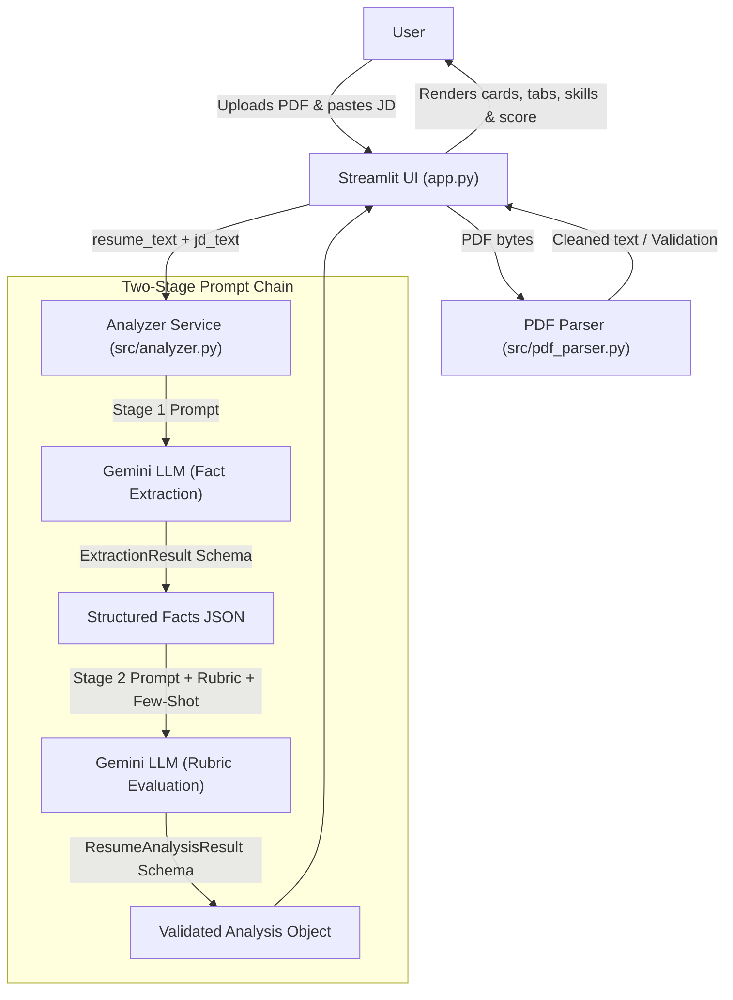

# AI Resume Analyzer: JD-Based Resume Evaluation

An academic Prompt Engineering application that analyzes a candidate's resume against a job description (JD) using **LangChain**, **Google Gemini**, and **Pydantic** structured outputs within an intuitive **Streamlit** user interface.

> **Academic Context:** Developed as a college Prompt Engineering assignment demonstrating advanced prompting techniques without relying on external databases, embeddings, or agentic frameworks.

---

## 🌟 Key Features

1. **PDF Text Extraction:** Reads text-based candidate resumes in PDF format using `pypdf`, with automatic detection and graceful rejection of scanned, image-only, or empty PDFs.
2. **Two-Stage Prompt Chaining:**
   - **Stage 1 (Extraction):** Extracts only stated resume facts and categorizes JD requirements into required skills, preferred skills, and core responsibilities.
   - **Stage 2 (Evaluation):** Compares the isolated facts against JD requirements using a strict 100-point rubric.
3. **Structured Pydantic Outputs:** Guarantees deterministic, type-safe JSON models for both pipeline stages.
4. **Heuristic Match Score & Detailed Explanation:** Generates an evidence-based match score (0–100) with a written rationale and an explicit disclaimer distinguishing AI heuristics from real ATS or recruiter decisions.
5. **Skills Gap Analysis:** Side-by-side identification of explicitly matched skills versus missing qualifications.
6. **Section-by-Section Feedback:** Evaluates Summary, Skills, Projects, Experience, and Education sections individually.
7. **Grounded Bullet Point Improvements:** Rewrites weak resume bullet points using action-oriented language while inserting bracketed placeholders (`[X]%`, `[Metric]`) instead of fabricating candidate metrics.
8. **Top 3 Priority Fixes:** Highlights the three highest-impact edits for the candidate to make before applying.

---

## 🧠 Prompt Engineering Techniques Demonstrated

| Technique | Implementation Location | Purpose & Academic Contribution |
| :--- | :--- | :--- |
| **Role Prompting** | `STAGE1_SYSTEM_PROMPT` & `STAGE2_SYSTEM_PROMPT` in `src/prompts.py` | Sets domain-specific personas: an objective **Technical Document Parser** for Stage 1, and a **Senior Technical Recruiter & Career Coach** for Stage 2. |
| **Prompt Chaining** | `analyze_resume()` in `src/analyzer.py` | Isolates objective factual extraction from subjective rubric evaluation in two sequential LLM calls, preventing the model from hallucinating resume facts to fit the JD. |
| **Few-Shot Prompting** | `STAGE2_SYSTEM_PROMPT` in `src/prompts.py` | Demonstrates how to classify skill gaps (e.g. MySQL vs. PostgreSQL) and how to rewrite weak bullets with placeholders (`[N] requests`, `[X]% latency`) without inventing numbers. |
| **Structured Output** | `with_structured_output()` in `src/analyzer.py` + `src/schemas.py` | Enforces Pydantic validation on all responses (`ExtractionResult` and `ResumeAnalysisResult`), preventing malformed UI rendering. |
| **Anti-Fabrication Constraints** | System prompts in `src/prompts.py` | Explicit negative constraints strictly forbid inventing skills, companies, degrees, dates, or numerical achievements. |

---

## 📐 Scoring Rubric (100 Points Total)

The match score is calculated using the following heuristic criteria:

1. **Required Skills & Core Qualifications (50 Points):** Points awarded strictly based on the proportion of required JD skills explicitly found in the candidate's resume. Unsupported skills receive **0 points**.
2. **Relevant Experience & Project Alignment (30 Points):** Evaluates how well documented work experience and projects demonstrate hands-on application of core role responsibilities.
3. **Preferred Skills & Education Fit (10 Points):** Bonus alignment for nice-to-have tools, certifications, or relevant academic degrees. Kept low so optional keywords never outweigh missing core requirements.
4. **Resume Clarity & Impact Presentation (10 Points):** Evaluates section organization and action-oriented bullet phrasing.
5. **Hard Cap Guardrail:** If the candidate matches **fewer than 50% of the required skills**, the total score **cannot exceed 50/100**, regardless of formatting or bonus keywords.

---

## 🏗️ Architecture



---

## 📂 Project Structure

```text
resumeanalyzer/
├── app.py                        # Single Streamlit entry point (run: streamlit run app.py)
├── src/
│   ├── __init__.py               # Package marker
│   ├── schemas.py                # Pydantic models for Stage 1 extraction & Stage 2 evaluation
│   ├── prompts.py                # Role prompts, few-shot examples, scoring rubric & templates
│   ├── analyzer.py               # Env/API key handling + 2-stage LangChain/Gemini pipeline
│   └── pdf_parser.py             # pypdf text extraction and empty/scanned PDF validation
├── tests/
│   ├── test_analyzer.py          # Unit tests for Pydantic schemas & mocked 2-stage LLM chain
│   ├── test_pdf_parser.py        # Unit tests for PDF extraction & validation
│   └── test_schemas.py           # Unit tests for Pydantic models & validation constraints
├── .env.example                  # Template showing GOOGLE_API_KEY and GEMINI_MODEL
├── requirements.txt              # Minimal required Python dependencies (7 packages)
├── IMPLEMENTATION_PLAN.md        # Reference phase-by-phase development plan
├── PROJECT_STATUS.md             # Living progress log and architectural decision record
└── README.md                     # Project documentation, prompt design & instructions
```

---

## 👥 Team Responsibilities

| Team Member | Role | Owned Deliverables |
| :--- | :--- | :--- |
| **Person 1** | **Backend, Prompt Engineering & LLM Integration** | • `src/schemas.py` (Pydantic models)<br>• `src/prompts.py` (Prompts, few-shot, rubric, anti-fabrication rules)<br>• `src/analyzer.py` (LangChain + Gemini 2-stage chain)<br>• `tests/test_analyzer.py` (Mocked pipeline & schema tests) |
| **Person 2** | **Streamlit UI, PDF Utility, Integration & Docs** | • `src/pdf_parser.py` (PDF extraction & scanned file checks)<br>• `app.py` (Streamlit UI, input handling, results presentation)<br>• `tests/test_pdf_parser.py` (PDF edge-case tests)<br>• `README.md` & `.env.example` |
| **Both** | **Review, Rubric Tuning & QA** | Co-review prompt wording, run end-to-end testing with sample resumes, maintain `PROJECT_STATUS.md`. |

---

## 🚀 Quickstart & Setup Guide

### 1. Prerequisites
- **Python 3.10 or newer** (tested on Python 3.13)
- A **Google Gemini API Key** (obtain free from [Google AI Studio](https://aistudio.google.com/))

### 2. Installation
Clone or navigate to the project directory:
```bash
cd resumeanalyzer
```

Install the dependencies:
```bash
python -m pip install -r requirements.txt
```

### 3. Environment Configuration
Create a `.env` file from the provided template:
```bash
# Windows PowerShell:
Copy-Item .env.example .env

# macOS / Linux:
cp .env.example .env
```

Open `.env` and insert your Gemini API key:
```env
GOOGLE_API_KEY=AIzaSy...your_actual_key_here
GEMINI_MODEL=gemini-3.5-flash-lite
GEMINI_FALLBACK_MODEL=gemini-3.8-flash
```
*(The system defaults to `gemini-3.5-flash-lite` and automatically falls back to `gemini-3.8-flash` if the primary model encounters a quota or API error).*

### 4. Run the Application
Launch the Streamlit app with a single command:
```bash
streamlit run app.py
```
Open your web browser at `http://localhost:8501`.

### 5. Run the Automated Tests
Run the offline test suite using `pytest`:
```bash
pytest tests/
```
All unit tests run offline using mocks and in-memory PDFs; **no live Gemini API key or network connection is required to run the tests**.

---

## ⚠️ Important Disclaimers & Ethics

- **Heuristic Estimate, Not ATS:** The match score is an AI-generated heuristic intended to assist candidates with resume tailoring. It does **not** replicate proprietary ATS algorithms (e.g. Workday, Taleo, Greenhouse).
- **No Prediction of Hiring:** This tool does **not** guarantee or predict interview callbacks or recruiter hiring decisions.
- **Data Privacy:** Resumes are processed in-memory and passed to Google Gemini solely for the duration of the analysis request. No resume data or personal information is stored, logged, or shared externally.
